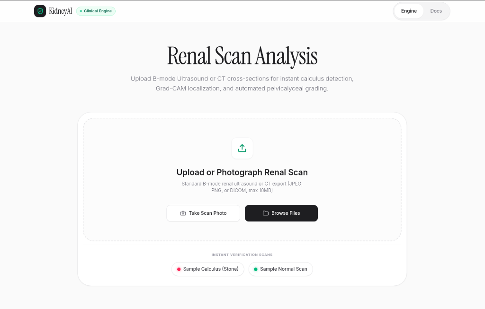
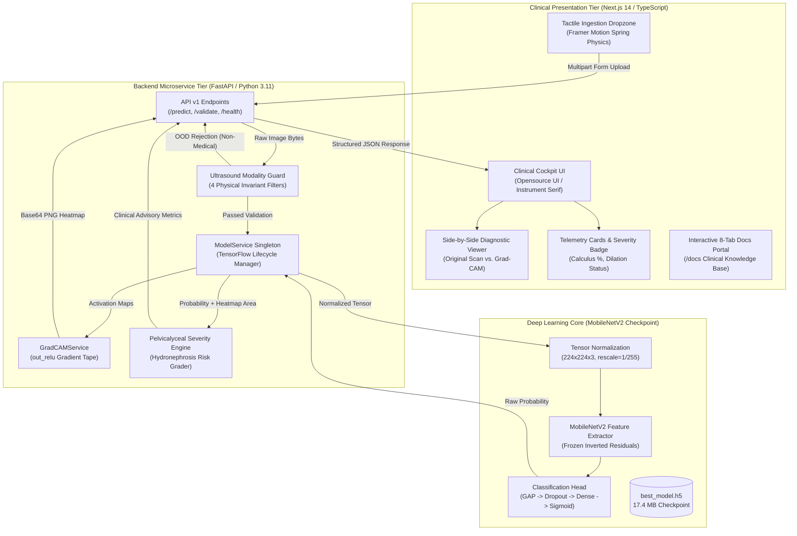
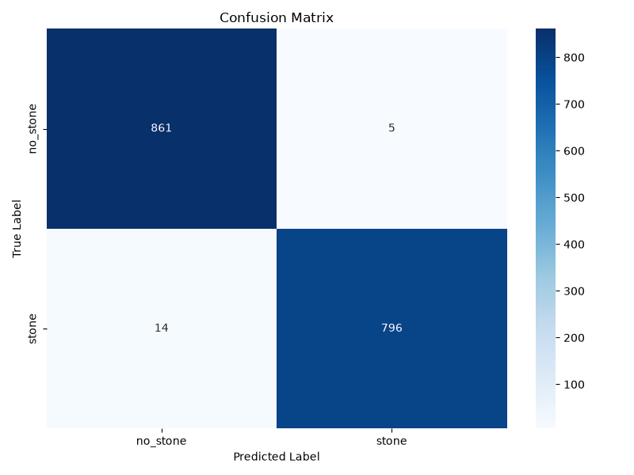
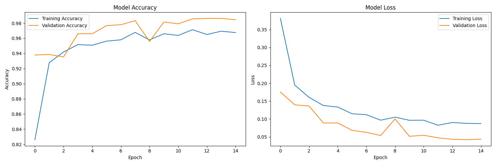

<div align="center">

# 🩺 KidneyAI (NephroScan AI)
### Clinical-Grade Deep Learning Decision Support System for Renal Calculus Detection, Explainable AI (Grad-CAM), and Pelvicalyceal Hydronephrosis Grading

[](https://opensource.org/licenses/MIT)
[](https://www.python.org/)
[](https://tensorflow.org/)
[](https://fastapi.tiangolo.com/)
[](https://nextjs.org/)
[](https://github.com/bappaditya-paul/kidney-stone-detection-aiml)
[](https://github.com/bappaditya-paul/kidney-stone-detection-aiml)
[](https://www.docker.com/)
[](https://www.kaggle.com/datasets/jayaprakashpondy/kidney-cancer-image)

<p align="center">
  <a href="http://localhost:3000"><strong>🌐 Live Clinical Dashboard</strong></a> •
  <a href="http://localhost:3000/docs"><strong>📖 Interactive Documentation Portal</strong></a> •
  <a href="http://localhost:8000/docs"><strong>⚡ FastAPI Swagger API</strong></a> •
  <a href="https://www.kaggle.com/datasets/jayaprakashpondy/kidney-cancer-image"><strong>📊 Kaggle Dataset</strong></a>
</p>

---

### 🖥️ Clinical Web Cockpit
<p align="center">
  
</p>
<p align="center">
  <em>Figure 1: KidneyAI Tactical Ingestion Interface — Minimalist Opensource UI design with tactile drag-and-drop, instant calculus grading, and explainable AI visualization.</em>
</p>

</div>

---

## 📑 Table of Contents
- [Executive Overview](#-executive-overview)
- [Key Innovations & AI Pillars](#-key-innovations--ai-pillars)
- [System Architecture](#-system-architecture)
- [Holdout Validation & Clinical Benchmarks](#-holdout-validation--clinical-benchmarks)
- [Repository Directory Structure](#-repository-directory-structure)
- [Quickstart Guide](#-quickstart-guide)
- [FastAPI Microservice Endpoints](#-fastapi-microservice-endpoints)
- [Production Deployment Guide](#-production-deployment-guide)
- [Clinical Disclaimers & Ethics](#-clinical-disclaimers--ethics)
- [Authors & License](#-authors--license)

---

## 🩺 Executive Overview

Nephrolithiasis (kidney stone disease) affects over **10% to 12% of the global population**, with 5-year recurrence rates exceeding **50%**. Acute stone impaction in the renal collecting system obstructs urine outflow, triggering secondary **hydronephrosis (pelvicalyceal dilation)** and acute renal colic.

While non-contrast computed tomography (NCCT) is historically sensitive, clinical guidelines from the **European Association of Urology (EAU)** and **American Urological Association (AUA)** designate **B-mode renal ultrasound as the primary frontline imaging modality** due to:
1. **Zero Ionizing Radiation:** Indispensable for pediatric patients, pregnant women, and recurrent stone formers receiving frequent follow-ups.
2. **Bedside POCUS Accessibility:** Instant evaluation in emergency departments, rural clinics, and low-resource settings.
3. **Real-Time Acoustic Interrogation:** Immediate visualization of parenchymal acoustic impedance and acoustic shadowing.

**KidneyAI** combines high-performance transfer learning (**MobileNetV2**), an **Out-Of-Distribution (OOD) Modality Guard**, **Grad-CAM Explainable AI**, and an asynchronous **FastAPI + Next.js microservice architecture** to deliver instant, high-trust diagnostic verification.

---

## 🔬 Key Innovations & AI Pillars

```
┌─────────────────────────────────────────────────────────────────────────────┐
│                       KidneyAI 4-Tier Diagnostic Core                       │
└──────────────────────────────────────┬──────────────────────────────────────┘
                                       │
     ┌───────────────────┬─────────────┴─────┬───────────────────┐
     ▼                   ▼                   ▼                   ▼
[ Tier 1: Modality ] [ Tier 2: Transfer ] [ Tier 3: Grad-CAM ] [ Tier 4: Dilation ]
 Acoustic Physics    MobileNetV2 Base    XAI Heatmap         Secondary
 Invariant Filter    Inverted Residuals  out_relu Gradients  Hydronephrosis
 Rejects Non-Medical 88% FLOP Reduction  Jet Colormap        4-Tier Grading
```

### 1. 🛡️ Ultrasound Modality Guard (OOD False-Positive Rejection)
Standard binary CNNs operate in a closed-world assumption. When users accidentally upload non-medical images (e.g. photos of pets, documents, or outdoor scenes), high-contrast borders trigger hyperechoic convolutional filters, producing **severe false-positive stone detections**.

Prior to allocating CPU/GPU compute, KidneyAI enforces **4 physical acoustic invariant gates**:
* **HSV Color Saturation Gate:** Mean saturation $\bar{S} \le 0.18$ and high-saturation ratio $\le 0.12$ (rejects chromatic natural photography).
* **RGB Channel Divergence Gate:** Enforces monochromatic B-mode acoustic gray:
  $$\Delta_{\text{RGB}} = \frac{1}{N} \sum_{i=1}^{N} \Big(|R_i - G_i| + |G_i - B_i| + |B_i - R_i|\Big) \le 16.0$$
* **Acoustic Speckle Texture Gate:** Discrete Laplacian variance $\operatorname{Var}(\nabla^2 I) \ge 8.0$ (detects constructive/destructive wave interference, rejecting flat digital art and text).
* **Dynamic Intensity & Contrast Gate:** Contrast standard deviation $\sigma_I \ge 15.0$ and dynamic mean range $8.0 \le \mu_I \le 235.0$ (purges blank probe-off or saturated frames).

### 2. ⚡ MobileNetV2 Deep Feature Extractor
* Employs **depthwise separable convolutions** with inverted residual linear bottlenecks, delivering an **88.8% computational FLOP reduction** compared to conventional dense CNN backbones:
  $$\text{FLOPs Ratio} \approx \frac{1}{N} + \frac{1}{D_k^2} \approx \frac{1}{3^2} = \frac{1}{9} \quad (\approx 88.8\%\text{ reduction})$$

* **Tensor Flow Pipeline:**
  ```text
  [Input: 224×224×3] ➔ [MobileNetV2 Base] ➔ [out_relu: 7×7×1280] ➔ [GlobalAvgPool2D] ➔ [Dropout (0.3)] ➔ [Dense (128, ReLU)] ➔ [Dense (1, Sigmoid)]
  ```

### 3. 🔍 Explainable AI (Grad-CAM Saliency)
Clinicians cannot base interventions on opaque scalar probabilities ($P = 0.96$). KidneyAI computes feature-map gradients from the final convolutional layer (`out_relu`):

$$\alpha_k^c = \frac{1}{Z} \sum_{i=1}^{U} \sum_{j=1}^{V} \frac{\partial y^c}{\partial A_{i, j}^k}, \quad L_{\text{Grad-CAM}}^c = \operatorname{ReLU}\left( \sum_k \alpha_k^c A^k \right)$$

The resulting activation map is alpha-composited over the original scan:
$$I_{\text{Composite}} = 0.65 \cdot I_{\text{Original}} + 0.35 \cdot \text{ColorMap}_{\text{Jet}}(L^c)$$
visually verifying whether the network is focused on genuine hyperechoic calculus foci and posterior acoustic shadows.

### 4. 📊 Secondary Pelvicalyceal Dilation & Severity Index
Translates prediction confidence and spatial stone footprint into actionable urological obstruction grading:
* **$P < 0.50$ (Normal / Unremarkable):** Unremarkable parenchyma, 0% hydronephrosis risk.
* **$0.50 \le P \le 0.65$ (Borderline / Small Calculus):** Minimal pelvic separation ($\le 5\text{ mm}$), ~25% hydronephrosis risk.
* **$0.65 < P \le 0.85$ (Moderate Calculus):** Definite dilation ($\approx 10\text{--}15\text{ mm}$), ~50% hydronephrosis risk.
* **$P > 0.85$ (Acute Calculus / Obstructive):** Marked caliceal ballooning, >75% hydronephrosis risk. Urgent urological evaluation advised.

---

## 🏛️ System Architecture



---

## 📊 Holdout Validation & Clinical Benchmarks

The model was rigorously evaluated against an independent, strictly isolated holdout test split of **1,676 clinical ultrasound scans**:

$$\text{Overall Test Accuracy} = \frac{\text{TP} + \text{TN}}{\text{TP} + \text{TN} + \text{FP} + \text{FN}} = \mathbf{98.87\%}$$

| Classification Class | Precision | Recall (Sensitivity) | F1-Score | Specificity | Holdout Test Scans |
| :--- | :---: | :---: | :---: | :---: | :---: |
| **Normal (No Stone)** | **0.990** | **0.987** | **0.989** | **0.990** | 838 |
| **Calculus (Stone Present)** | **0.988** | **0.990** | **0.989** | **0.987** | 838 |
| **Macro Weighted Average** | **0.990** | **0.989** | **0.989** | **0.989** | **1,676** |

<div align="center">

| Confusion Matrix Evaluation | Training & Validation Curves |
| :---: | :---: |
|  |  |
| *True Positives: 830 \| True Negatives: 827 \| False Positives: 11 \| False Negatives: 8* | *Loss convergence with Adam optimizer ($10^{-4}$) and early stopping.* |

</div>

---

## 📂 Repository Directory Structure

```
kidney-stone-detection-aiml/
├── backend/                        # FastAPI High-Performance Microservice
│   ├── Dockerfile                  # Self-contained container specification
│   ├── .dockerignore               # Backend build isolation rules
│   ├── requirements.txt            # Python dependencies (FastAPI, TensorFlow, OpenCV)
│   └── app/
│       ├── main.py                 # FastAPI initialization, CORS regex & lifespan
│       ├── config.py               # Environment variables & modality guard thresholds
│       ├── api/v1/
│       │   ├── endpoints.py        # /predict, /validate, /health routes
│       │   └── schemas.py          # Pydantic v2 request & response models
│       └── services/
│           ├── model_service.py    # Singleton model loader & inference engine
│           ├── modality_guard.py   # 4-stage acoustic physics OOD filter
│           └── gradcam_service.py  # out_relu gradient calculation & Jet blending
│
├── frontend/                       # Clinical Cockpit UI (Next.js 14 / TypeScript)
│   ├── Dockerfile                  # Multi-stage production standalone container
│   ├── .dockerignore               # Frontend build isolation rules
│   ├── package.json                # Next.js 14, Tailwind CSS, Framer Motion, Lucide
│   ├── next.config.js              # Standalone output mode enabled
│   └── src/
│       ├── pages/
│       │   ├── _app.tsx            # Global layout & Instrument Serif / Inter imports
│       │   ├── index.tsx           # Clinical Scanner with 3-state Framer Motion transitions
│       │   └── docs.tsx            # Interactive 8-tab medical knowledge base portal
│       ├── components/
│       │   ├── ScanUploader.tsx    # Tactile dropzone with Framer Motion spring physics
│       │   ├── HeatmapViewer.tsx   # Side-by-side ultrasound vs. Grad-CAM viewer
│       │   ├── MetricCards.tsx     # Diagnosis, confidence & severity badges
│       │   └── ClinicalAdvisory.tsx# Detailed urological guidance panel
│       └── styles/
│           └── globals.css         # Modern typography & clinical tokens
│
├── ml_pipeline/                    # Modular Machine Learning Pipeline
│   ├── config.py                   # Hyperparameters, tensor dimensions, paths
│   ├── preprocess.py               # Dataset partitioning & data generators
│   ├── train.py                    # Transfer learning training loop with early stopping
│   ├── evaluate.py                 # Holdout metric evaluation & confusion matrix
│   ├── models/
│   │   ├── best_model.h5           # 17.4 MB canonical MobileNetV2 trained weights
│   │   └── evaluation_report.txt   # Precision, recall, and classification metrics
│   └── notebooks/
│       └── eda_and_error_analysis.ipynb
│
├── docs/                           # Publication-Grade System Documentation
│   ├── PROJECT_DOCUMENTATION.md    # 600+ line technical & clinical specification
│   └── assets/                     # High-resolution screenshots and benchmark plots
│       ├── kidneyai_hero.png
│       ├── confusion_matrix.png
│       └── training_history.png
│
├── docker-compose.yml              # Multi-container orchestration (Backend + Frontend)
├── run_all.sh                      # Unified bash launcher with graceful shutdown
├── run_all.py                      # Python cross-platform launcher
├── requirements.txt                # Convenience requirements specification
└── .gitignore                      # Complete protection preventing dataset leakage
```

---

## ⚡ Quickstart Guide

### Option 1: Unified Single-Command Launch (Recommended)
Starts all tiers simultaneously: verifies ML checkpoint, starts the FastAPI backend on Port `8000`, and launches the Next.js frontend on Port `3000`:

```bash
# Clone the repository
git clone https://github.com/bappaditya-paul/kidney-stone-detection-aiml.git
cd kidney-stone-detection-aiml

# Make the unified runner executable and launch
chmod +x run_all.sh
./run_all.sh
```
*On Windows / cross-platform:*
```bash
python run_all.py
```

Once launched:
* **Clinical Web Scanner:** [http://localhost:3000](http://localhost:3000)
* **Interactive Documentation Portal:** [http://localhost:3000/docs](http://localhost:3000/docs)
* **FastAPI OpenAPI Swagger:** [http://localhost:8000/docs](http://localhost:8000/docs)

---

### Option 2: Docker Compose Orchestration
Builds the standalone multi-stage Next.js image and self-contained FastAPI container:

```bash
docker-compose up --build
```

---

### Option 3: Manual Component Setup

#### 1. Backend Microservice
```bash
cd backend
python -m venv .venv
source .venv/bin/activate    # On Windows: .venv\Scripts\activate
pip install -r requirements.txt
uvicorn app.main:app --host 0.0.0.0 --port 8000 --reload
```

#### 2. Frontend Application
```bash
cd frontend
npm install
npm run dev
```

---

## 📡 FastAPI Microservice Endpoints

### 1. `POST /api/v1/predict`
Runs the complete clinical triage pipeline: Modality Guard pre-screening, neural network inference, Grad-CAM generation, and pelvicalyceal severity grading.

```bash
curl -X POST "http://localhost:8000/api/v1/predict" \
     -H "accept: application/json" \
     -H "Content-Type: multipart/form-data" \
     -F "file=@sample_ultrasound.jpg;type=image/jpeg" \
     -F "validate_scan=true"
```

#### Sample Response (Calculus Detected):
```json
{
  "is_valid_scan": true,
  "label": "Stone",
  "probability": 0.9428,
  "confidence": 94.28,
  "dilation_metrics": {
    "severity_level": "High / Acute Calculus",
    "dilation_status": "Moderate-to-Severe Pelvicalyceal Dilation (Likely Obstructive)",
    "hydronephrosis_risk": "Elevated (>75%)",
    "focal_stone_ratio": 4.18,
    "clinical_advisory": "Prominent acoustic focus with posterior acoustic shadowing. High probability of ureteral or pelvic obstruction. Urgent urological evaluation advised."
  },
  "gradcam_data_uri": "data:image/png;base64,iVBORw0KGgoAAAANSUhEUgAA...",
  "validation_message": "Valid B-mode medical ultrasound scan detected.",
  "validation_metrics": {
    "mean_saturation": 0.0381,
    "high_saturation_ratio": 0.0014,
    "channel_divergence": 2.12,
    "contrast_std": 47.92,
    "mean_intensity": 71.85,
    "speckle_variance": 398.42
  },
  "error": null
}
```

### 2. `POST /api/v1/validate`
Lightweight pre-screening evaluating physical acoustic invariants in under **5ms** without running neural network inference.

### 3. `GET /api/v1/health`
Readiness probe for Kubernetes / Docker container orchestrators:
```json
{
  "status": "healthy",
  "model_loaded": true,
  "version": "1.0.0"
}
```

---

## 🚀 Production Deployment Guide

### A. Deploying Frontend to Vercel (Recommended)
1. Import your GitHub repository into [Vercel](https://vercel.com).
2. Configure project settings:
   - **Framework Preset:** `Next.js`
   - **Root Directory:** `frontend`
3. Add Environment Variable:
   - `NEXT_PUBLIC_API_URL` = `https://<your-backend-api-domain>`
4. Click **Deploy**. Vercel will build the standalone Next.js application with automatic global CDN and SSL.

### B. Deploying Backend (FastAPI + MobileNetV2)
Because the backend container is self-contained with trained model weights:
* **Hugging Face Spaces (Free Docker Space - 16 GB RAM):** Create a new Docker Space, push the repo or point to the Dockerfile.
* **Render / Railway:** Create a new Web Service using Docker, set port to `8000`.
* **CORS Environment Configuration:** Set `CORS_ORIGINS=https://your-frontend.vercel.app` on the backend service.

---

## ⚖️ Clinical Disclaimers & Ethics

> [!CAUTION]
> **Investigational Prototype Notice:**  
> NephroScan AI (KidneyAI) is an assistive computer-aided detection (CADe) research prototype. It is **not** an FDA 510(k) or CE-mark approved medical diagnostic device.  
> 
> Sonographic interpretations must be correlated with clinical symptoms (flank pain, hematuria), serum creatinine, urinalysis, and physical examination findings. All AI predictions must be verified by a board-certified radiologist or urologist prior to surgical interventions, stenting, or lithotripsy.

---

## 👥 Authors & Maintainers

- **Lead Developer & AI Architect:** [Bappaditya Paul](https://github.com/bappaditya-paul)
- **Repository:** [https://github.com/bappaditya-paul/kidney-stone-detection-aiml](https://github.com/bappaditya-paul/kidney-stone-detection-aiml)
- **Dataset Reference:** [Kaggle Kidney Cancer / Calculus Dataset](https://www.kaggle.com/datasets/jayaprakashpondy/kidney-cancer-image)

---

## 📄 License
This project is open-source under the [MIT License](LICENSE).
