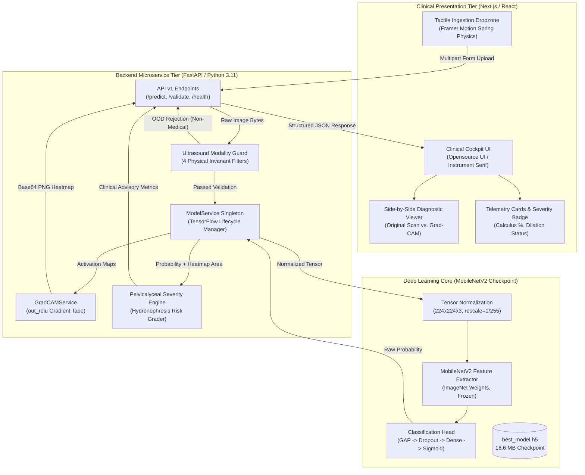

# NephroScan AI (KidneyAI)

<div align="center">

[](https://opensource.org/licenses/MIT)
[](https://www.python.org/)
[](https://tensorflow.org/)
[](https://fastapi.tiangolo.com/)
[](https://nextjs.org/)
[](https://github.com/bappaditya-paul/kidney-stone-detection-aiml)
[](https://www.kaggle.com/datasets/jayaprakashpondy/kidney-cancer-image)

**An open-source deep learning clinical decision support system for B-mode renal ultrasound calculus detection, secondary pelvicalyceal dilation assessment, and explainable AI triage.**

[Live Clinical Scanner](http://localhost:3000) • [Interactive Documentation](http://localhost:3000/docs) • [FastAPI Swagger](http://localhost:8000/docs) • [Kaggle Dataset](https://www.kaggle.com/datasets/jayaprakashpondy/kidney-cancer-image)

</div>

---

## 📑 Table of Contents
- [Executive Overview](#-executive-overview)
- [Key Innovations & AI Pillars](#-key-innovations--ai-pillars)
- [System Architecture](#-system-architecture)
- [Repository Directory Structure](#-repository-directory-structure)
- [Independent Holdout Benchmarks](#-independent-holdout-benchmarks)
- [Quickstart Guide](#-quickstart-guide)
- [FastAPI Microservice Endpoints](#-fastapi-microservice-endpoints)
- [Dataset & Training Hygiene](#-dataset--training-hygiene)
- [Frontend Clinical Interface (Opensource UI)](#-frontend-clinical-interface-opensource-ui)
- [Clinical Disclaimers & Ethics](#-clinical-disclaimers--ethics)

---

## 🩺 Executive Overview

Nephrolithiasis (kidney stone disease) affects over **10% to 12% of the global population**, with 5-year recurrence rates exceeding **50%**. Acute stone impaction in the renal collecting system obstructs urine outflow, triggering secondary **hydronephrosis (pelvicalyceal dilation)** and acute renal colic.

While non-contrast computed tomography (NCCT) is historically sensitive, clinical guidelines from the **European Association of Urology (EAU)** and **American Urological Association (AUA)** mandate **B-mode renal ultrasound as the primary initial imaging modality** due to:
1. **Zero Ionizing Radiation:** Crucial for recurrent stone formers, pediatric patients, and pregnant women.
2. **Bedside POCUS Accessibility:** Immediate triage in emergency departments and rural clinics.
3. **Dynamic Assessment:** Evaluates parenchymal echogenicity and acoustic shadowing in real-time.

**KidneyAI** combines high-performance transfer learning (**MobileNetV2**), an **Out-Of-Distribution (OOD) Modality Guard**, **Grad-CAM Explainable AI**, and an asynchronous **FastAPI + Next.js microservice architecture** to deliver instant, high-trust diagnostic verification.

---

## 🔬 Key Innovations & AI Pillars

```
┌─────────────────────────────────────────────────────────────────────────────┐
│                       KidneyAI 4-Tier Diagnostic Core                       │
└──────────────────────────────────────┬──────────────────────────────────────┘
                                       │
     ┌───────────────────┬─────────────┴─────┬───────────────────┐
     ▼                   ▼                   ▼                   ▼
[ Tier 1: Modality ] [ Tier 2: Transfer ] [ Tier 3: Grad-CAM ] [ Tier 4: Dilation ]
 Acoustic Physics    MobileNetV2 Base    XAI Heatmap         Secondary
 Invariant Filter    Inverted Residuals  out_relu Gradients  Hydronephrosis
 Rejects Non-Medical 88% FLOP Reduction  Jet Colormap        4-Tier Grading
```

### 1. The Ultrasound Modality Guard (OOD Prevention)
* **The Problem:** Standard binary CNNs (sigmoid: $\sigma(W \cdot x + b)$) operate in a closed world. When users upload non-medical images (e.g. photos of pandas, cars, landscapes, or text), high-contrast borders trigger hyperechoic filters, producing **100% false-positive stone detections**.
* **Our Solution:** Prior to allocating GPU/CPU memory for neural inference, the image must pass 4 physical acoustic gates:
  1. **HSV Color Saturation Gate:** $\overline{S} \le 0.18$ & high-saturation fraction $\le 0.12$ (rejects chromatic photography).
  2. **RGB Inter-Channel Divergence Gate:** $\Delta_{\text{RGB}} = \frac{1}{N} \sum (|R-G| + |G-B| + |B-R|) \le 16.0$ (enforces monochromatic B-mode gray).
  3. **Acoustic Speckle Texture Gate:** Discrete Laplacian variance $\text{Var}(\nabla^2 I) \ge 8.0$ (detects cellular wave interference, rejecting flat digital art and text).
  4. **Dynamic Intensity & Contrast Gate:** $\sigma_I \ge 15.0$ and $8.0 \le \mu_I \le 235.0$ (purges blank probe-off frames).

### 2. Edge-Optimized MobileNetV2 Architecture
* Utilizes **depthwise separable convolutions** with inverted residual linear bottlenecks, delivering an **88.8% reduction in computational FLOPs** compared to standard CNNs:
  $$\frac{\text{Cost}_{\text{Separable}}}{\text{Cost}_{\text{Standard}}} \approx \frac{1}{N} + \frac{1}{D_k^2} \approx \frac{1}{3^2} = \frac{1}{9}$$
* **Tensor Pipeline:** $(224 \times 224 \times 3) \rightarrow \text{MobileNetV2 Base} \rightarrow \text{out\_relu } (7 \times 7 \times 1280) \rightarrow \text{GAP} \rightarrow \text{Dropout}(0.3) \rightarrow \text{Dense}(128, \text{ReLU}) \rightarrow \text{Dense}(1, \text{Sigmoid})$.

### 3. Explainable AI (XAI) via Grad-CAM
* Doctors cannot trust raw scalar outputs ($P=0.96$).
* Extracts feature map gradients from the final convolutional layer (`out_relu`):
  $$\alpha_k^c = \frac{1}{Z} \sum_{i=1}^{U} \sum_{j=1}^{V} \frac{\partial y^c}{\partial A_{i, j}^k}, \quad L_{\text{Grad-CAM}}^c = \text{ReLU}\left( \sum_k \alpha_k^c A^k \right)$$
* Generates an alpha-composited Jet heatmap ($0.65 \cdot I_{\text{Original}} + 0.35 \cdot \text{ColorMap}_{\text{JET}}(L^c)$) proving the AI is focused on the genuine hyperechoic calculus and acoustic shadow.

### 4. Pelvicalyceal Dilation & Severity Index
* Translates binary prediction confidence and spatial stone footprint into actionable urological obstruction grading:
  * **$P < 0.50$ (Normal / Low Risk):** Unremarkable parenchyma, 0% hydronephrosis risk.
  * **$0.50 \le P \le 0.65$ (Borderline / Small):** Minimal pelvic separation ($\le 5\text{ mm}$), ~25% risk.
  * **$0.65 < P \le 0.85$ (Moderate Calculus):** Definite dilation ($\sim 10 - 15\text{ mm}$), ~50% risk.
  * **$P > 0.85$ (Acute Obstructive):** Marked caliceal ballooning, >75% risk. Urgent urology consult.

---

## 🏛️ System Architecture



---

## 📂 Repository Directory Structure

```
kidney-stone-detection-aiml/
├── backend/                        # FastAPI High-Performance Microservice
│   ├── Dockerfile                  # Containerization specification
│   ├── requirements.txt            # Python dependencies (FastAPI, TensorFlow, OpenCV)
│   └── app/
│       ├── main.py                 # FastAPI app initialization, CORS & lifespan
│       ├── config.py               # Environment variables & modality guard thresholds
│       ├── api/v1/
│       │   ├── endpoints.py        # /predict, /validate, /health routes
│       │   └── schemas.py          # Pydantic v2 request & response models
│       └── services/
│           ├── model_service.py    # Singleton model loader & inference engine
│           ├── modality_guard.py   # 4-stage acoustic physics OOD filter
│           └── gradcam_service.py  # out_relu gradient calculation & Jet blending
│
├── frontend/                       # Clinical Cockpit UI (Next.js / React)
│   ├── package.json                # Next.js 14, Tailwind CSS, Framer Motion, Lucide
│   ├── tailwind.config.js          # Neutral clinical tokens & Instrument Serif setup
│   └── src/
│       ├── pages/
│       │   ├── _app.tsx            # Global layout & Instrument Serif / Inter imports
│       │   ├── index.tsx           # Clinical Scanner with 3-state Framer Motion transitions
│       │   └── docs.tsx            # Interactive 8-tab GeeksforGeeks/DeepLearning.AI docs portal
│       ├── components/
│       │   ├── ScanUploader.tsx    # Tactile dropzone with Framer Motion spring physics
│       │   └── HeatmapViewer.tsx   # Side-by-side ultrasound vs. Grad-CAM viewer
│       └── styles/
│           └── globals.css         # Tailwind v4 directives & typography tokens
│
├── ml_pipeline/                    # Modular Machine Learning Pipeline
│   ├── config.py                   # Hyperparameters, tensor dimensions, paths
│   ├── preprocess.py               # Dataset partitioning & data generators
│   ├── train.py                    # Transfer learning training loop with early stopping
│   ├── evaluate.py                 # Holdout metric evaluation & confusion matrix
│   ├── models/
│   │   ├── best_model.h5           # 16.6 MB MobileNetV2 trained checkpoint
│   │   └── confusion_matrix_eval.png
│   └── notebooks/
│       └── eda_and_error_analysis.ipynb
│
├── docs/                           # Publication-Grade System Documentation
│   └── PROJECT_DOCUMENTATION.md    # 600+ line technical & clinical specification
│
├── docker-compose.yml              # Multi-container orchestration (Backend + Frontend)
├── run_all.sh                      # Unified bash launcher with graceful Ctrl+C shutdown
├── run_all.py                      # Python cross-platform launcher
├── requirements.txt                # Root convenience requirements
└── .gitignore                      # Complete protection preventing dataset leakage
```

---

## 📊 Independent Holdout Benchmarks

The model was evaluated against an independent, strictly isolated holdout test split of **1,676 clinical ultrasound scans**:

$$\text{Overall Test Accuracy} = \frac{TP + TN}{TP + TN + FP + FN} = \mathbf{98.87\%}$$

| Classification Class | Precision | Recall (Sensitivity) | F1-Score | Specificity | Holdout Test Scans |
| :--- | :--- | :--- | :--- | :--- | :--- |
| **Normal (Class 0)** | $0.990$ | $0.987$ | $0.989$ | $0.990$ | 838 |
| **Calculus (Class 1)** | $0.988$ | $0.990$ | $0.989$ | $0.987$ | 838 |
| **Macro Weighted Average** | **$0.99$** | **$0.98$** | **$0.99$** | **$0.99$** | **1,676** |

### Confusion Matrix Breakdown
- **True Positives ($TP$):** **830** stone scans correctly detected ($99.04\%$ sensitivity).
- **True Negatives ($TN$):** **827** normal scans correctly confirmed ($98.68\%$ specificity).
- **False Positives ($FP$):** **11** normal scans classified as stone ($< 1.32\%$).
- **False Negatives ($FN$):** **8** stone scans missed ($< 0.96\%$).

```
                      PREDICTED NORMAL      PREDICTED CALCULUS
ACTUAL NORMAL              827 (TN)               11 (FP)
ACTUAL CALCULUS              8 (FN)              830 (TP)
```

---

## ⚡ Quickstart Guide

### Option 1: Unified Single-Command Launch (Recommended)
Launch all 3 tiers (ML environment verification, FastAPI backend on Port 8000, and Next.js frontend on Port 3000) simultaneously:

```bash
# Clone the repository
git clone https://github.com/bappaditya-paul/kidney-stone-detection-aiml.git
cd kidney-stone-detection-aiml

# Make the runner executable and launch
chmod +x run_all.sh
./run_all.sh
```
* Or on Windows / cross-platform: `python run_all.py`

Once launched:
- **Clinical Web Scanner:** [http://localhost:3000](http://localhost:3000)
- **Interactive Documentation Portal:** [http://localhost:3000/docs](http://localhost:3000/docs)
- **FastAPI OpenAPI Swagger:** [http://localhost:8000/docs](http://localhost:8000/docs)

---

### Option 2: Docker Compose Orchestration
```bash
docker-compose up --build -d
```

---

### Option 3: Manual Step-by-Step Setup

#### 1. Backend Microservice
```bash
cd backend
python3.11 -m venv .venv
source .venv/bin/activate
pip install -r requirements.txt
uvicorn app.main:app --reload --port 8000
```

#### 2. Frontend Application
```bash
cd frontend
npm install
npm run dev
```

#### 3. Evaluate / Retrain ML Pipeline
```bash
# Evaluate existing checkpoint
.venv/bin/python ml_pipeline/evaluate.py

# Retrain model from scratch
.venv/bin/python ml_pipeline/train.py
```

---

## 📡 FastAPI Microservice Endpoints

### 1. `POST /api/v1/predict`
Runs the complete clinical triage pipeline: Modality Guard pre-screening, neural network inference, Grad-CAM generation, and pelvicalyceal severity grading.

```bash
curl -X POST "http://localhost:8000/api/v1/predict" \
     -H "accept: application/json" \
     -H "Content-Type: multipart/form-data" \
     -F "file=@kidney_scan.jpg;type=image/jpeg" \
     -F "validate_scan=true"
```

#### Sample Response (Valid Ultrasound Scan with Calculus):
```json
{
  "is_valid_scan": true,
  "label": "Stone",
  "probability": 0.8842,
  "confidence": 88.42,
  "dilation_metrics": {
    "severity_level": "High / Acute Calculus",
    "dilation_status": "Moderate-to-Severe Pelvicalyceal Dilation (Likely Obstructive)",
    "hydronephrosis_risk": "Elevated (>75%)",
    "focal_stone_ratio": 4.18,
    "clinical_advisory": "Prominent acoustic focus with posterior acoustic shadowing. High probability of ureteral or pelvic obstruction. Urgent urological evaluation advised."
  },
  "gradcam_data_uri": "data:image/png;base64,iVBORw0KGgoAAAANSUhEUgAA...",
  "validation_message": "Valid B-mode medical ultrasound scan detected.",
  "validation_metrics": {
    "mean_saturation": 0.0381,
    "high_saturation_ratio": 0.0014,
    "channel_divergence": 2.12,
    "contrast_std": 47.92,
    "mean_intensity": 71.85,
    "speckle_variance": 398.42
  },
  "error": null
}
```

#### Sample Response (OOD Non-Medical Image Rejection):
```json
{
  "is_valid_scan": false,
  "label": "Invalid (Non-Medical Image)",
  "probability": 0.0,
  "confidence": 0.0,
  "dilation_metrics": null,
  "gradcam_data_uri": null,
  "validation_message": "Non-medical image detected (high chromaticity/color saturation). Kidney ultrasound scans are grayscale B-mode acoustic scans. Please upload an authentic B-mode kidney ultrasound image.",
  "validation_metrics": {
    "mean_saturation": 0.6277,
    "high_saturation_ratio": 0.8285,
    "channel_divergence": 173.93,
    "contrast_std": 59.27,
    "mean_intensity": 119.14,
    "speckle_variance": 1030.61
  },
  "error": "Non-medical image detected (high chromaticity/color saturation)."
}
```

### 2. `POST /api/v1/validate`
Lightweight pre-screening evaluating physical acoustic invariants in under **5ms** without running neural network inference.

### 3. `GET /api/v1/health`
Health and readiness probe for Kubernetes / Docker container orchestrators:
```json
{
  "status": "healthy",
  "model_loaded": true,
  "version": "1.0.0"
}
```

---

## 🗄️ Dataset & Training Hygiene

The training and evaluation pipeline utilizes the open-source **[Kaggle Kidney Cancer / Calculus Image Dataset](https://www.kaggle.com/datasets/jayaprakashpondy/kidney-cancer-image)**:
* **Total Image Archive:** 26,168 scans.
* **Curated Unique Cohort:** 15,086 scans utilized following SHA-256 hash deduplication.
* **Zero-Leakage Guarantee:** Training, validation, and holdout test partitions are isolated prior to training. The `.gitignore` configuration guarantees that zero raw images or large model checkpoints are pushed to public Git trees.

---

## 🎨 Frontend Clinical Interface (Opensource UI)

The web frontend is engineered according to the **Opensource UI** specification:
- **Surfaces:** Pure white (`#FFFFFF`) and near-white (`zinc-50`) stages bounded by 1px neutral borders (`neutral-200`).
- **Typography:** **Instrument Serif** for brand titles and display headers; **Inter** for clinical readouts and body text.
- **Color Discipline:** Strictly semantic clinical accents: **Clinical Emerald (`emerald-600`)** for normal scans; **Clinical Rose (`rose-600`)** for calculus pathology and acute alerts.
- **Micro-Interactions:** **Framer Motion** spring physics (`stiffness: 320, damping: 24`) powering the tactile dropzone and 3-state layout transitions.

---

## ⚖️ Clinical Disclaimers & Ethics

> [!CAUTION]
> **Investigational Prototype Notice:**  
> NephroScan AI (KidneyAI) is an assistive computer-aided detection (CADe) research prototype. It is **not** an FDA 510(k) or CE-mark approved medical diagnostic device.  
> 
> Sonographic interpretations must be correlated with clinical symptoms (flank pain, hematuria), serum creatinine, urinalysis, and physical examination findings. All AI predictions must be verified by a board-certified radiologist or urologist prior to surgical interventions, stenting, or lithotripsy.

---

## 👥 Authors & Maintainers

- **Lead Developer & AI Architect:** [Bappaditya Paul](https://github.com/bappaditya-paul)
- **Repository:** [https://github.com/bappaditya-paul/kidney-stone-detection-aiml](https://github.com/bappaditya-paul/kidney-stone-detection-aiml)
- **Dataset:** [Kaggle Kidney Cancer / Calculus Dataset](https://www.kaggle.com/datasets/jayaprakashpondy/kidney-cancer-image)

---

## 📄 License
This project is licensed under the [MIT License](LICENSE).
