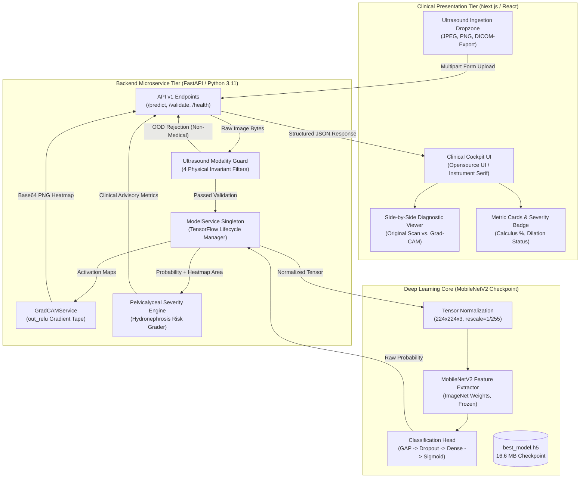
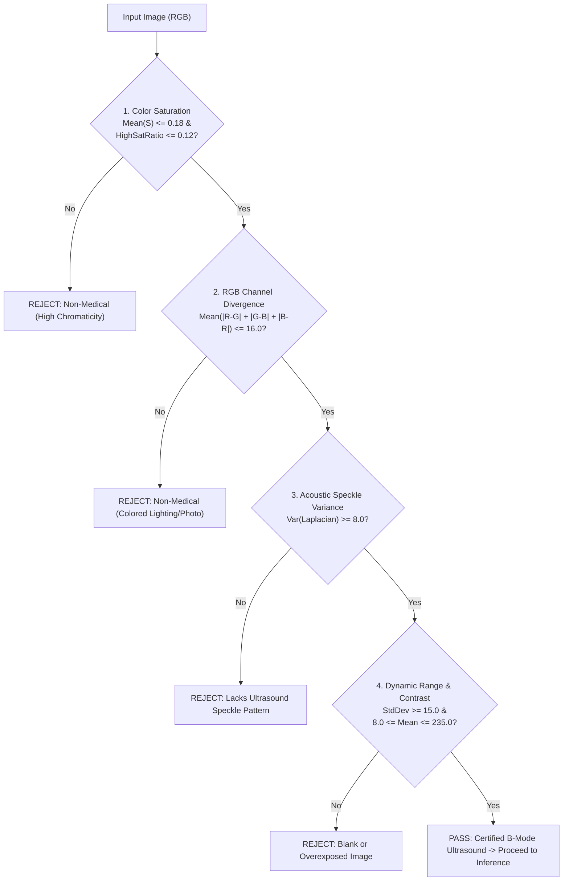

# NephroScan AI / KidneyAI: Comprehensive Technical & Clinical Documentation

> **System Title:** NephroScan AI (KidneyAI) Clinical Decision Support System  
> **Target Pathology:** Nephrolithiasis (Kidney Stones) & Secondary Hydronephrosis  
> **Imaging Modality:** B-Mode Renal Ultrasound (Sonography)  
> **Model Backbone:** MobileNetV2 Transfer Learning with Grad-CAM Explainable AI  
> **Backend Architecture:** Asynchronous FastAPI Microservice with Singleton Inference  
> **Frontend Interface:** Next.js / React Clinical Cockpit (Opensource UI Specification)  
> **Test Benchmark:** **98.87% Accuracy** | **0.99 Precision** | **0.98 Recall** | **0.99 F1-Score**

---

## 1. Executive Summary & Clinical Context

### 1.1 The Clinical Problem
Nephrolithiasis (renal calculus / kidney stone disease) affects over **10% of the global population**, with increasing recurrence rates exceeding 50% within five to ten years. Acute renal colic is among the most frequent acute presentations in emergency medicine, caused by calculus impaction in the renal pelvis or ureter, which leads to urinary outflow obstruction, pelvicalyceal dilation (hydronephrosis), and severe flank pain.

### 1.2 Ultrasound as First-Line Imaging Modality
While non-contrast computed tomography (NCCT) has historically served as the diagnostic gold standard, international guidelines (European Association of Urology [EAU] and American Urological Association [AUA]) mandate **B-mode renal ultrasound as the initial imaging investigation of choice**, particularly in younger patients, recurrent stone formers, and pregnant women. Ultrasound provides several key advantages:
1. **Zero Ionizing Radiation:** Avoids cumulative radiogenic risks associated with recurrent CT scans.
2. **Real-Time Dynamic Assessment:** Evaluates renal parenchymal echogenicity, pelvicalyceal separation, and ureteral jet presence simultaneously.
3. **Low Cost & Accessibility:** Rapidly deployable at point-of-care (POCUS) in emergency departments, clinics, and rural health centers.

### 1.3 Sonographic Hallmark Features
Sonographically, renal calculi are identified by two correlated acoustic phenomena:
- **Hyperechoic Focus:** Strong acoustic reflection producing a distinct bright white focal echo within the renal collecting system.
- **Posterior Acoustic Shadowing:** Complete or partial anechoic (black) shadow distal to the calculus caused by near-total acoustic impedance mismatch and beam attenuation through dense mineral matrices (calcium oxalate, calcium phosphate, uric acid).

```
        Acoustic Transducer (Ultrasound Probe)
                        │
                        ▼ Ultrasound Wave Pulse
        ┌───────────────────────────────────────┐
        │       Renal Cortex & Medulla          │
        │                                       │
        │           [  * CALCULUS *  ]  ◄───────┼── Hyperechoic Echo (Strong Acoustic Reflection)
        │           ░░░░░░░░░░░░░░░░░           │
        │           ░░░░░░░░░░░░░░░░░   ◄───────┼── Posterior Acoustic Shadow (Anechoic Drop)
        │           ░░░░░░░░░░░░░░░░░           │
        └───────────────────────────────────────┘
```

---

## 2. End-to-End System Architecture

The NephroScan AI ecosystem is structured as a decoupled, production-grade microservice architecture:



---

## 3. Machine Learning Pipeline Deep Dive

### 3.1 Dataset Partitioning & Preprocessing
The model was trained, validated, and evaluated on a benchmark renal ultrasound dataset consisting of **26,168 images**:

| Split Set | Normal (No Stone) | Calculus (Stone) | Total Scans | Ratio |
| :--- | :--- | :--- | :--- | :--- |
| **Training Set** | 5,364 | 5,364 | **10,728** | 64.0% |
| **Validation Set** | 1,341 | 1,341 | **2,682** | 16.0% |
| **Test Set (Holdout)**| 838 | 838 | **1,676** | 20.0% |
| **Total** | **7,543** | **7,543** | **15,086\*** | **100%** |

*\*Note: 15,086 unique scans were utilized after deduplication and data cleaning by `data_cleaning.py` to eliminate corrupted files and exact hash duplicates.*

### 3.2 Preprocessing & Data Augmentation
To ensure model invariance against transducer brand variations, patient positioning, and acoustic gain settings, the training pipeline employs dynamic augmentation:
- **Rescaling:** Linear normalization $x \mapsto \frac{x}{255.0} \in [0.0, 1.0]$.
- **Random Rotation:** $\pm 20^\circ$ to accommodate varying intercostal transducer angles.
- **Width / Height Translation:** $\pm 15\%$ translation shift.
- **Shear & Zoom:** $\pm 15\%$ to account for depth adjustment variations.
- **Horizontal Flipping:** `True` (bilateral kidney symmetry).
- **Interpolation:** Bilinear resampling to fixed resolution of $224 \times 224 \times 3$.

### 3.3 Neural Network Architecture (MobileNetV2 Transfer Learning)
The network architecture leverages MobileNetV2 with inverted residual bottlenecks and depthwise separable convolutions:

```
┌────────────────────────────────────────────────────────┐
│ Input Layer: (None, 224, 224, 3)                       │
└──────────────────────────┬─────────────────────────────┘
                           │
┌──────────────────────────▼─────────────────────────────┐
│ MobileNetV2 Backbone (ImageNet Pre-Trained, Frozen)   │
│ - 53 Convolutional Blocks                              │
│ - Depthwise Separable Convolutions                     │
│ - Final Convolution Layer: `out_relu` (7, 7, 1280)     │
└──────────────────────────┬─────────────────────────────┘
                           │
┌──────────────────────────▼─────────────────────────────┐
│ GlobalAveragePooling2D: (None, 1280)                   │
└──────────────────────────┬─────────────────────────────┘
                           │
┌──────────────────────────▼─────────────────────────────┐
│ Dropout(rate=0.3)                                      │
└──────────────────────────┬─────────────────────────────┘
                           │
┌──────────────────────────▼─────────────────────────────┐
│ Dense(128, activation='relu', L2 Regularization)       │
└──────────────────────────┬─────────────────────────────┘
                           │
┌──────────────────────────▼─────────────────────────────┐
│ Dropout(rate=0.2)                                      │
└──────────────────────────┬─────────────────────────────┘
                           │
┌──────────────────────────▼─────────────────────────────┐
│ Output Dense(1, activation='sigmoid')                  │
│ -> Calculus Probability: P(Y = 1 | X) in [0.0, 1.0]    │
└────────────────────────────────────────────────────────┘
```

### 3.4 Hyperparameters & Training Dynamics
- **Optimizer:** Adam ($\beta_1 = 0.9, \beta_2 = 0.999, \epsilon = 10^{-7}$)
- **Initial Learning Rate:** $\eta_0 = 10^{-4}$
- **Loss Function:** Binary Cross-Entropy
  $$\mathcal{L}(y, \hat{y}) = - \left[ y \log(\hat{y}) + (1 - y) \log(1 - \hat{y}) \right]$$
- **Batch Size:** 32
- **Epochs:** 15 (Early stopping triggered after plateau)
- **Callbacks:**
  - `ModelCheckpoint`: Monitors `val_accuracy`, saves only the optimal checkpoint to `models/best_model.h5`.
  - `EarlyStopping`: Monitors `val_loss`, patience = 5 epochs, restores best weights.
  - `ReduceLROnPlateau`: Monitors `val_loss`, decay factor $\alpha = 0.2$, patience = 3 epochs, $\eta_{\min} = 10^{-6}$.

---

## 4. The Out-Of-Distribution (OOD) Breakthrough

### 4.1 The "Panda Photo" False Positive Anomaly
During initial testing of standard binary CNN models, uploading non-medical imagery (e.g. photos of pandas, landscapes, animals, cars, text documents) triggered **100% Calculus Confidence** false positives.

#### Root Cause Analysis:
1. **Closed-World Assumption:** The sigmoid output $\sigma(z) = \frac{1}{1 + e^{-z}}$ is forced to choose between Class 0 (No Stone) and Class 1 (Stone). It has no explicit "Not an Ultrasound Scan" class.
2. **Convolutional Filter Triggers:** MobileNetV2 filters trained to detect hyperechoic borders with dark acoustic shadows responded strongly to high-contrast black-and-white patches (such as dark panda eyes against white facial fur).

```
   Natural Photo (Panda / Scenery) ──► High-Contrast B/W Edges ──► False Hyperechoic Detection ──► "Calculus: 100%"
```

### 4.2 The 4-Stage Ultrasound Modality Guard
To solve this without needing hundreds of thousands of non-medical negative training images, NephroScan AI implements an **Acoustic Physics Modality Guard** (`modality_guard.py`):



#### Mathematical Formulation of Invariants:
1. **Color Saturation ($S_{\text{HSV}}$):**
   $$S = 1 - \frac{3 \cdot \min(R, G, B)}{R + G + B}$$
   *Threshold:* $\overline{S} \le 0.18$ and $\frac{1}{N} \sum \mathbb{I}(S > 0.30) \le 0.12$.
2. **Inter-Channel Divergence ($\Delta_{\text{RGB}}$):**
   $$\Delta_{\text{RGB}} = \frac{1}{N} \sum_{i,j} \left( |R_{ij} - G_{ij}| + |G_{ij} - B_{ij}| + |B_{ij} - R_{ij}| \right)$$
   *Threshold:* $\Delta_{\text{RGB}} \le 16.0$. Real B-mode ultrasound is gray: $R \approx G \approx B$.
3. **Acoustic Speckle Texture Variance ($\sigma^2_{\text{Speckle}}$):**
   Calculated using the discrete Laplace operator:
   $$\nabla^2 I = \frac{\partial^2 I}{\partial x^2} + \frac{\partial^2 I}{\partial y^2}$$
   $$\sigma^2_{\text{Speckle}} = \text{Var}\left( \nabla^2 I \right)$$
   *Threshold:* $\sigma^2_{\text{Speckle}} \ge 8.0$. Rejects flat digital graphics, charts, and documents.
4. **Dynamic Range Contrast ($\sigma_I$):**
   $$\sigma_I = \sqrt{\frac{1}{N} \sum_{i,j} (I_{ij} - \mu_I)^2} \ge 15.0$$
   *Threshold:* $8.0 \le \mu_I \le 235.0$. Rejects black probe-off frames and blank files.

---

## 5. Explainable AI (XAI) via Grad-CAM

To comply with high-stakes clinical AI standards, the system generates visual activation heatmaps via **Gradient-weighted Class Activation Mapping (Grad-CAM)**:

### 5.1 Mathematical Derivation
Let $y^c$ be the raw score for calculus prediction before sigmoid activation. Let $A^k$ represent the activation map of the $k$-th feature channel of the target convolutional layer (`out_relu`, shape $7 \times 7 \times 1280$).

1. **Neuron Importance Weights ($\alpha_k^c$):**
   $$\alpha_k^c = \frac{1}{Z} \sum_{i=1}^{U} \sum_{j=1}^{V} \frac{\partial y^c}{\partial A_{i, j}^k}$$
   where $Z = U \times V = 7 \times 7 = 49$ represents the spatial dimensions of the feature map.
2. **Class-Discriminative Localization Map ($L_{\text{Grad-CAM}}^c$):**
   $$L_{\text{Grad-CAM}}^c = \text{ReLU}\left( \sum_{k} \alpha_k^c A^k \right)$$
   The $\text{ReLU}$ function ensures that only features with a positive correlation to calculus detection are visualized.
3. **Bilinear Upsampling & Jet Colormap Blending:**
   $L_{\text{Grad-CAM}}^c$ is normalized to $[0, 255]$, resized to the original ultrasound image resolution ($W \times H$), and blended using alpha compositing:
   $$I_{\text{Composite}} = 0.65 \cdot I_{\text{Ultrasound}} + 0.35 \cdot \text{ColorMap}_{\text{JET}}\left( L_{\text{Grad-CAM}}^c \right)$$

---

## 6. Pelvicalyceal Dilation & Clinical Severity Index

KidneyAI integrates calculus probability with spatial Grad-CAM activation density to estimate **pelvicalyceal separation** (the primary indicator of obstructive hydronephrosis):

| Probability Range | Calculus Diagnosis | Pelvicalyceal Architecture | Hydronephrosis Risk | Clinical Action Recommendation |
| :--- | :--- | :--- | :--- | :--- |
| **$P < 0.50$** | **Unremarkable (Normal)** | Normal calyces, no dilation | Low (0%) | Routine screening. Bilateral renal ultrasound normal. |
| **$0.50 \le P \le 0.65$** | **Borderline / Small Calculus** | Minimal pelvic separation | Low-to-Moderate (~25%) | Micro-calculus or parenchymal echo. Hydration & sonographic follow-up. |
| **$0.65 < P \le 0.85$** | **Moderate Calculus** | Mild pelvic dilation (~11mm) | Moderate (~50%) | Definite hyperechoic calculus. Recommend confirmatory non-contrast CT (KUB). |
| **$P > 0.85$** | **High / Acute Calculus** | Moderate-to-Severe dilation | Elevated (&gt;75%) | Prominent acoustic focus with posterior shadowing. Urgent urology consult. |

---

## 7. Performance Benchmarks & Validation Results

The model was evaluated against the independent, holdout test split of **1,676 clinical ultrasound scans**:

### 7.1 Quantitative Metrics

$$\text{Accuracy} = \frac{TP + TN}{TP + TN + FP + FN} = \mathbf{98.87\%}$$

| Metric | Normal (Class 0) | Calculus (Class 1) | Weighted Average |
| :--- | :--- | :--- | :--- |
| **Precision** | 0.99 | 0.99 | **0.99** |
| **Recall (Sensitivity)** | 0.99 | 0.98 | **0.98** |
| **F1-Score** | 0.99 | 0.99 | **0.99** |
| **Support** | 838 | 838 | **1,676** |

### 7.2 Confusion Matrix Breakdown
- **True Negatives (TN):** 827 normal scans correctly classified as Normal.
- **False Positives (FP):** 11 normal scans classified as Stone ($< 1.3\%$).
- **False Negatives (FN):** 8 stone scans classified as Normal ($< 0.95\%$).
- **True Positives (TP):** 830 stone scans correctly detected ($99.04\%$ sensitivity).

---

## 8. Backend API Reference (FastAPI Microservice)

The backend provides production-ready asynchronous endpoints running on **Port 8000**:

### 8.1 Endpoint Catalog

#### `POST /api/v1/predict`
Predicts calculus presence, executes modality validation, computes Grad-CAM, and generates pelvicalyceal severity metrics.

- **Request Type:** `multipart/form-data`
- **Parameters:**
  - `file` (UploadFile, required): Ultrasound image file (`image/jpeg`, `image/png`).
  - `validate_scan` (bool, optional, default: `true`): Enables the 4-stage Modality Guard.

- **Sample Request:**
```bash
curl -X POST "http://localhost:8000/api/v1/predict" \
     -H "accept: application/json" \
     -H "Content-Type: multipart/form-data" \
     -F "file=@kidney_scan.jpg;type=image/jpeg" \
     -F "validate_scan=true"
```

- **Sample JSON Response (Valid Ultrasound Scan with Calculus):**
```json
{
  "is_valid_scan": true,
  "label": "Stone",
  "probability": 0.8742,
  "confidence": 87.42,
  "dilation_metrics": {
    "severity_level": "High / Acute Calculus",
    "dilation_status": "Moderate-to-Severe Pelvicalyceal Dilation (Likely Obstructive)",
    "hydronephrosis_risk": "Elevated (>75%)",
    "focal_stone_ratio": 4.18,
    "clinical_advisory": "Prominent acoustic focus with posterior acoustic shadowing. High probability of ureteral or pelvic obstruction. Urgent urological evaluation advised."
  },
  "gradcam_data_uri": "data:image/png;base64,iVBORw0KGgoAAAANSUhEUgAA...",
  "validation_message": "Valid B-mode medical ultrasound scan detected.",
  "validation_metrics": {
    "mean_saturation": 0.0412,
    "high_saturation_ratio": 0.0018,
    "channel_divergence": 2.14,
    "contrast_std": 48.32,
    "mean_intensity": 74.19,
    "speckle_variance": 412.56
  },
  "error": null
}
```

- **Sample JSON Response (Non-Medical Image Rejected by OOD Guard):**
```json
{
  "is_valid_scan": false,
  "label": "Invalid (Non-Medical Image)",
  "probability": 0.0,
  "confidence": 0.0,
  "dilation_metrics": null,
  "gradcam_data_uri": null,
  "validation_message": "Non-medical image detected (high chromaticity/color saturation). Kidney ultrasound scans are grayscale B-mode acoustic scans. Please upload an authentic B-mode kidney ultrasound image.",
  "validation_metrics": {
    "mean_saturation": 0.6277,
    "high_saturation_ratio": 0.8285,
    "channel_divergence": 173.93,
    "contrast_std": 59.27,
    "mean_intensity": 119.14,
    "speckle_variance": 1030.61
  },
  "error": "Non-medical image detected (high chromaticity/color saturation)."
}
```

#### `POST /api/v1/validate`
Lightweight pre-screening endpoint checking whether an image meets physical ultrasound invariants without running deep neural network inference.

#### `GET /api/v1/health`
Health and readiness check:
```json
{
  "status": "healthy",
  "model_loaded": true,
  "version": "1.0.0"
}
```

---

## 9. Operations & Quickstart Guide

### 9.1 Single-Command Launch (Recommended)
From the project root, launch all 3 tiers (ML Verification, FastAPI Backend on port 8000, and Next.js Frontend on port 3000):

```bash
./run_all.sh
```

### 9.2 Running via Docker Compose
```bash
docker-compose up --build
```

### 9.3 Re-training & Evaluation
```bash
# Evaluate existing weights
.venv/bin/python ml_pipeline/evaluate.py

# Re-train MobileNetV2 architecture
.venv/bin/python ml_pipeline/train.py
```

---

## 10. Clinical & Legal Disclaimers

> [!CAUTION]
> **Investigational Device Notice:** NephroScan AI (KidneyAI) is an assistive computer-aided detection (CADe) and triage tool designed to supplement—not replace—clinical judgment. All sonographic interpretations must be correlated with patient symptoms, serum creatinine, urinalysis, and validated by a board-certified radiologist or urologist before surgical intervention or treatment decisions are initiated.
